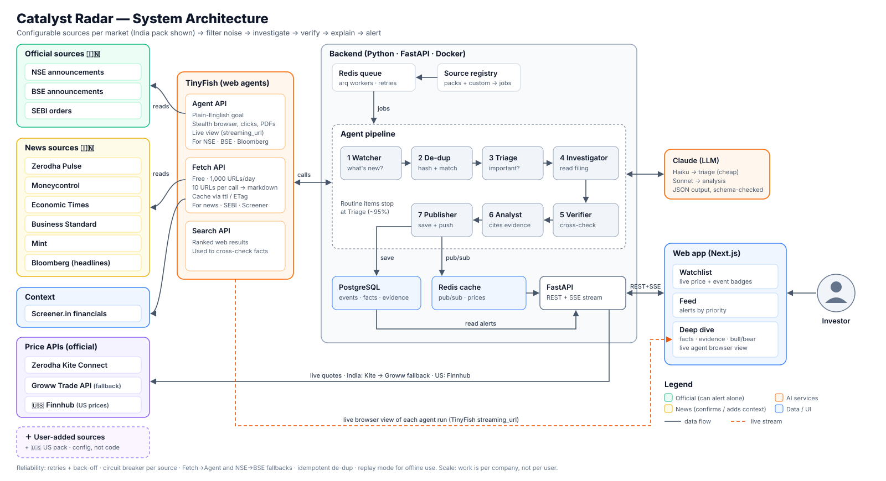

# Catalyst Radar — Architecture



> **Deploying for free?** See [docs/ARCHITECTURE-FREE-TIER.md](docs/ARCHITECTURE-FREE-TIER.md): Databricks Free Edition (jobs, Delta, Lakebase, model serving) + Vercel (website), with Live / Local (LM Studio) / Mock modes side by side.

*Diagram source for the Eraser VS Code extension: [docs/architecture.eraserdiagram](docs/architecture.eraserdiagram) · Pipeline sequence: [docs/pipeline-sequence.eraserdiagram](docs/pipeline-sequence.eraserdiagram)*

---

## 1. The big picture in one paragraph

**Watchers** check 10 websites on a schedule using TinyFish. New items are **de-duplicated** and matched to companies on someone's watchlist. A cheap **Triage** step drops routine noise. For the few items that matter, an **Investigator** agent opens the original filing, a **Verifier** cross-checks it against other sources, and an **Analyst** (Claude) writes the alert, with every claim tied to a piece of stored evidence. Alerts are saved and pushed live to the web app, along with each agent's progress and a live browser view.

## 2. Layers

| Layer | What it does | Tech |
|---|---|---|
| **1. Sources** | Market source packs (India: 10 sites) + user-added sources ([SOURCES.md](SOURCES.md)) + price APIs | NSE, BSE, SEBI, Pulse, news sites, Bloomberg, Screener · Kite Connect, Groww |
| **2. Ingestion** | Read pages on a schedule, turn them into clean "raw items" | Scheduler + TinyFish **Fetch** (simple pages) / **Agent** (hard pages) |
| **3. Queue** | Hand work between steps; retry failures; spread work over workers | Redis + `arq` workers |
| **4. Agent pipeline** | Triage → Investigate → Verify → Analyse → Publish | Python workers · TinyFish Agent/Fetch/Search · Claude |
| **5. Storage** | Companies, items, evidence, facts, alerts, agent runs | PostgreSQL (SQLite locally) · Redis cache |
| **6. API** | REST for the app + live event stream | FastAPI · Server-Sent Events (SSE) |
| **7. Web app** | Market switcher · Watchlist · Feed · Deep dive (live agent view) · Sources | Next.js (React) + Tailwind + Framer Motion ([DESIGN.md](docs/DESIGN.md)) |

## 3. The agent pipeline (step by step)

| # | Agent | Input → Output | Tool | Why it exists |
|---|---|---|---|---|
| 1 | **Watcher** (one per source) | Source URL → list of raw items `{title, url, published_at, source}` | TinyFish Fetch (`ttl`, ETag) or Agent with `output_schema` | Cheap, frequent "what's new?" checks |
| 2 | **Normaliser + De-dup** | Raw item → `item` linked to company, or dropped | Symbol/alias matching, SHA-256 content hash | The same news appears on 5 sites; process it once |
| 3 | **Triage** | Item → `{event_type, materiality 0–100, reason}` | Keyword rules first, then Claude Haiku | 90%+ of filings are routine; stop them before expensive steps |
| 4 | **Investigator** | Material item → extracted **facts** from the original filing/PDF | TinyFish Agent (`goal` + `output_schema`) on NSE/BSE | Read the *primary* source, not the headline |
| 5 | **Verifier** | Facts → each fact marked `confirmed / conflicting / unconfirmed` with evidence links | TinyFish Search + Fetch on other sources | Trust: "proof, not just AI opinion" |
| 6 | **Analyst** | Facts + evidence + context (Screener financials, Kite price reaction) → alert JSON | Claude Sonnet, Pydantic-validated JSON | Explains "why it matters", bull/bear, what to check next |
| 7 | **Publisher** | Alert → DB + live push to UI | Postgres + Redis pub/sub → SSE | Real-time feed |

**Grounding rule:** the Analyst must reference an `evidence_id` for every factual claim. Output that cites unknown evidence or makes uncited numeric claims is **rejected and retried once**, then marked "needs review".

## 4. Configuration & multi-market

Three things are configurable without code changes: **markets**, **sources**, and **watchlists**.

```
Market ──< Exchange ──< Listing >── Company ──< Event ──< Alert
   │                       ▲
   └──< Source (built-in pack or user-added; scope = market | exchange | company)
User ──< WatchlistItem >── Listing   (with per-item: exchanges to watch, sources on/off)
```

- **Company vs Listing:** a *company* is the business (Infosys). A *listing* is where it trades (`INFY` on NSE in ₹, `INFY` on BSE in ₹, `INFY` ADR on NYSE in $). Events attach to the **company**, so news is found once and shown on every listing. Prices attach to the **listing**.
- **Market packs:** `config/markets/<market>.yaml` holds exchanges, currency, timezone, trading hours, price provider, and built-in sources. They're loaded into the DB at startup (upsert by `id`).
- **Price providers:** one `PriceProvider` interface (`quote(listings)`, `history(listing, range)`) with `KiteProvider`, `GrowwProvider`, and `FinnhubProvider`. A market lists providers in fallback order.
- **Custom sources:** stored in the same `sources` table with `builtin=false, created_by=user`. On save, the **Source Tester** runs a TinyFish Fetch (and an Agent run if needed) and returns a preview; the method that worked (`fetch` or `agent`) is remembered.
- **Shared watchers:** the scheduler watches each `(url, method)` pair **once**, however many users added it. User-level on/off toggles filter what reaches *their* feed, not what we fetch.
- **Exchange choice:** a watchlist item stores `exchanges=[NSE]`, `[BSE]`, or `[NSE,BSE]`, which decides which exchange sources feed that user's alerts for that stock.

## 5. Data model (simplified)

```
markets(id, name, flag, currency, timezone, open_time, close_time, price_providers[])
exchanges(id, market_id, code)                       -- NSE, BSE, NYSE, NASDAQ
companies(id, name, aliases[], ir_url, sector)
listings(id, company_id, exchange_id, symbol, currency, provider_token)
users(id, name, default_market_id)
watchlist_items(user_id, listing_id, exchanges_watched[], position, added_at)
sources(id, name, url, market_id, exchange_id NULL, company_id NULL,
        scope[market|exchange|company], trust[official|news|context|unverified],
        method[fetch|agent|auto], goal, browser_profile, interval_s,
        builtin, created_by NULL, enabled, health[ok|degraded|paused], last_ok_at)
user_source_prefs(user_id, source_id, listing_id NULL, enabled)
raw_items(id, source_id, url, title, published_at, content_hash UNIQUE, fetched_at)
events(id, company_id, raw_item_id, event_type, materiality, status)
evidence(id, event_id, url, source_id, excerpt, captured_at)
facts(id, event_id, key, value, verification[confirmed|conflicting|unconfirmed], evidence_ids[])
alerts(id, event_id, priority, sentiment, what_happened, why_it_matters,
       risks, bull_case, bear_case, next_steps, created_at)
agent_runs(id, event_id, step, provider, tinyfish_run_id, status,
           started_at, finished_at, cost_estimate, error)
```

## 6. Reliability — what happens when things break

| Failure | What we do |
|---|---|
| Website slow / blocked | Timeout → retry with exponential back-off (max 3) → **circuit breaker** pauses that source for 15 min; other sources keep running |
| Fetch can't read a page (JS-heavy) | Automatic **fallback Fetch → Agent** |
| NSE blocks us | Fall back to **BSE** (same filings) |
| TinyFish SSE stream drops | Poll `GET /v1/runs/{id}` until `COMPLETED / FAILED` (documented recovery path) |
| Agent loops forever | `agent_config.max_steps` and `max_duration_seconds` hard caps |
| Claude returns bad JSON | Schema validation → one retry with the error → else "needs review" |
| Same news from 5 sites | `content_hash UNIQUE` + event merge, so the job is **idempotent** (safe to re-run) |
| Kite down | Fall back to **Groww** API → else show last cached price with "stale" badge |
| Offline, or out of free API credits | **Replay mode**: recorded TinyFish/LLM responses in `fixtures/` replayed with real timings |

## 7. Scalability — how it grows

- **Work is per company, not per user.** 10,000 users following Reliance trigger *one* pipeline run. Cost grows with *companies watched*, not *users*.
- **Cheap-first funnel:** thousands of items → free Fetch + rules → ~5% to Claude Haiku → ~1% to Agent + Sonnet. Expensive steps run only on what matters.
- **Batching:** Fetch reads 10 URLs per call; Kite returns 1,000 quotes per call; TinyFish bulk-async starts up to 100 agent runs at once.
- **Horizontal workers:** stateless `arq` workers; add more containers to go faster. Each source has its own queue and rate limit.
- **At scale:** switch agent runs from SSE to TinyFish `webhook_url` callbacks; move to managed Postgres + Redis; full-text search for the evidence store.

## 8. Design decisions

| # | Decision | Alternatives considered | Why we chose it |
|---|---|---|---|
| D1 | **TinyFish** for reading websites | BeautifulSoup/Playwright scrapers | Sites like NSE block simple bots and change layout. TinyFish agents follow natural-language goals and survive layout changes; the live view is great for demos and debugging. |
| D2 | **Fetch first, Agent only when needed** | Agent for everything | Fetch is free (1,000 URLs/day) and fast; the Agent costs money and takes longer. |
| D3 | **Official APIs for prices** (Kite, Groww) | Scrape prices | Prices must be accurate and allowed; APIs are both. |
| D4 | **Rules + small model before big model** | Send everything to one large model | 10–50× cheaper; most filings are routine. |
| D5 | **Facts and analysis stored separately** | One free-text summary | Lets the UI show "verified" vs "opinion", and lets us check every claim. |
| D6 | **Structured JSON everywhere** (`output_schema`, Pydantic) | Free text | Machine-checkable, testable, no parsing surprises. |
| D7 | **Python (FastAPI) backend + Next.js frontend** | Single full-stack JS app | Python has the Kite/Groww/Claude SDKs and is best for data work; Next.js gives a polished UI fast. |
| D8 | **Redis queue** | Celery / Kafka | Light, enough for a personal project, and scales to many workers. |
| D9 | **No buy/sell calls** | Signal-style ratings | Avoids regulatory risk (SEBI research analyst rules) and keeps user trust. |
| D10 | **Sources and markets as config** (YAML packs + DB rows) | Hard-coded scrapers per site | A new source is data, not a deploy. A new market is one YAML file plus one price provider. |
| D11 | **Company ≠ Listing** | One row per ticker | Dual-listed companies (NSE+BSE, India+US ADR) get news once and prices per exchange and currency. |
| D12 | **Custom sources start "Unverified"** | Trust whatever users add | Users get flexibility without junk sites triggering high-priority alerts. |
| D13 | **Shared watchers per URL** | One watcher per user per source | Cost stays flat as users grow; user toggles only filter their own feed. |

## 9. Production standards

- **Config:** all keys in environment variables (`.env.example` committed, `.env` git-ignored). Kite `api_secret` stays on the server only.
- **Code quality:** type hints + `mypy`, `ruff` lint/format, TypeScript strict mode.
- **Tests:** unit tests for de-dup, triage rules, schema validation; integration tests using recorded fixtures (no live calls in CI).
- **Observability:** structured JSON logs with `event_id` / `run_id`; every agent step saved in `agent_runs` (status, duration, cost); `/health` and `/ready` endpoints.
- **Packaging:** `docker-compose up` starts API, workers, Postgres, Redis, and the web app.
- **Safety:** rate limits per source, robots/ToS-friendly polling, short excerpts only, clear "not investment advice" labels.

## 10. API surface

| Method | Path | Purpose |
|---|---|---|
| `GET` | `/api/watchlist?market=` | Stocks grouped by market + live prices + new-event counts |
| `POST` | `/api/watchlist` | Add a company `{symbol}` |
| `GET` | `/api/alerts?company=&priority=` | Feed |
| `GET` | `/api/alerts/{id}` | Deep dive: facts, evidence, bull/bear, agent runs |
| `POST` | `/api/scan/{symbol}` | Trigger a scan now ("Scan now" button) |
| `DELETE` | `/api/watchlist/{listing_id}` | Remove a stock |
| `PATCH` | `/api/watchlist/{listing_id}` | Set exchanges to watch (`NSE` / `BSE` / both), per-stock source toggles |
| `GET` | `/api/markets` | Markets with flag, currency, open/closed status |
| `GET` | `/api/instruments/search?q=&market=` | Find stocks to add (from exchange instrument lists) |
| `GET` | `/api/sources?market=` | Built-in + custom sources with health |
| `POST` | `/api/sources/test` | Test a URL → preview items + method that worked |
| `POST` | `/api/sources` | Save a custom source |
| `PATCH` | `/api/sources/{id}` | Enable / disable / edit interval |
| `GET` | `/api/stream` | SSE: agent progress, TinyFish `streaming_url`, new alerts |
| `GET` | `/health` | Liveness |
