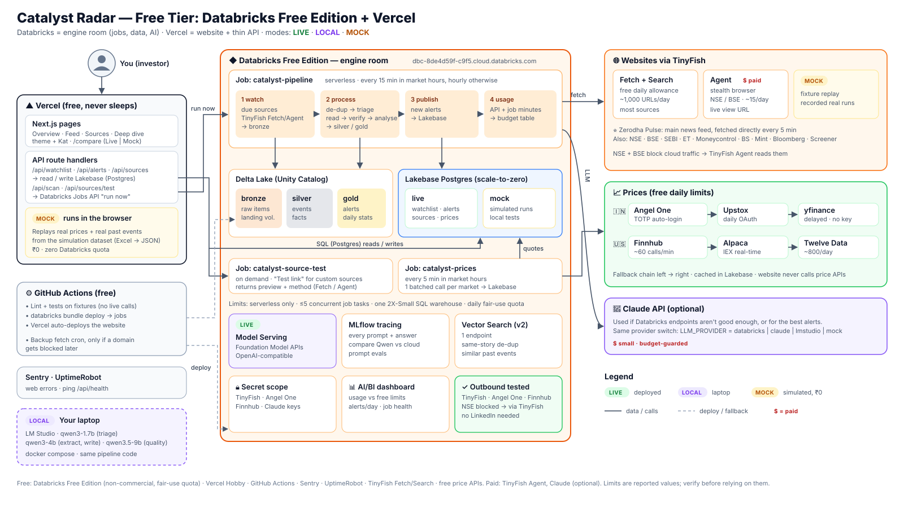

# Catalyst Radar — Free-Tier Architecture (Databricks + Vercel)



*Eraser source: [architecture-free-tier.eraserdiagram](architecture-free-tier.eraserdiagram) · Full design: [ARCHITECTURE.md](../ARCHITECTURE.md)*

**In one line:** **Databricks Free Edition is the engine room** (scheduled jobs, data, AI). **Vercel hosts the website**, and its API routes read results straight from Databricks' Postgres (Lakebase). Every outside service sits behind a switch: **Live**, **Local** (LM Studio on the laptop) or **Mock** (simulated, side by side with Live).

Workspace: `https://dbc-8de4d59f-c9f5.cloud.databricks.com`

---

## 1. Who does what

| Layer | Service (free) | What it does here |
|---|---|---|
| **Website + API** | **Vercel** Hobby | Next.js UI (theme + Kat) **and** API route handlers. Reads Lakebase, triggers Databricks jobs. Never sleeps. |
| **Scheduler + pipeline** | **Databricks Jobs** (serverless) | Runs the pipeline on a schedule: Watch → De-dup → Triage → Read → Verify → Analyse → Publish |
| **App database** | **Databricks Lakebase** (Postgres, scale-to-zero) | Fast reads for the website: watchlist, alerts, sources, prices. `live` and `mock` schemas. |
| **History / analytics** | **Delta tables** in Unity Catalog | Bronze (raw items) → Silver (events, facts) → Gold (alerts, daily stats). Cheap to keep everything. |
| **AI in the cloud** | **Databricks Model Serving** (Foundation Model APIs) | LLM calls from jobs through an OpenAI-compatible endpoint (whatever models Free Edition offers) |
| **AI on the laptop** | **LM Studio** | Qwen3 models for free local development |
| **Similar-news search** *(v2)* | **Databricks Vector Search** (1 endpoint) | "Same story worded differently" de-dup; "similar past events" |
| **LLM tracing + evals** | **MLflow** (built in) | Trace every prompt/answer; compare local vs cloud models |
| **Secrets** | Databricks secret scopes + Vercel env vars | API keys never in code |
| **Usage dashboard** | Databricks AI/BI dashboard | API usage vs free limits, alerts per day, job health |
| **CI/CD** | GitHub Actions + Databricks Asset Bundles | Tests on fixtures; `databricks bundle deploy` for jobs; Vercel auto-deploys the web |
| **Errors / uptime** | Sentry · UptimeRobot (free) | Web errors; ping `/api/health` |

### Why Vercel, not Render, for the website
- **No sleeping:** Render's free service sleeps after ~15 min idle and is slow to wake; Vercel serves instantly.
- **Next.js is Vercel's home turf:** UI and API routes deploy together from `git push`.
- **No separate backend needed:** the heavy work runs in Databricks Jobs, so the API is just "read Lakebase + trigger a job", which fits Vercel's serverless functions.
- **Why not a Databricks App for the website?** Apps sit behind Databricks login (fine for us, awkward to share), stop every 24 h, and count toward the 3-app limit. We may still use **one Databricks App as a private admin console** later.

## 2. Databricks Free Edition: limits that shape the design

| Limit (from Databricks docs, Nov 2026) | How we design around it |
|---|---|
| Serverless compute only; daily **fair-use quota** (exceed it → compute off for the day) | Short, efficient job runs; poll less outside market hours; budget table tracks job minutes |
| **5 concurrent job tasks** | One pipeline job with a few tasks; sources processed in batches, not one task each |
| **One SQL warehouse (2X-Small)** | Website reads **Lakebase**, not the warehouse; warehouse only for dashboards/ad-hoc SQL |
| **One Lakebase project** (scale-to-zero) | One database, two schemas (`live`, `mock`) |
| **Outbound internet limited to trusted domains** | ✅ Tested: TinyFish, Angel One, Finnhub, Anthropic reachable; NSE isn't, so it goes via TinyFish ([§5](#5-outbound-internet-tested-no-linkedin-verification-needed)) |
| Model serving: limited endpoints, no GPU, some models unavailable | Use whichever Foundation Model endpoints the **Serving** page shows; keep LM Studio for dev; Claude via API if reachable |
| **3 Apps**, each auto-stops after 24 h | Website on Vercel instead; optional admin app only |
| Non-commercial use only | Fine: personal project |

## 3. How a run works

```
Databricks Job "catalyst-pipeline" (every 15 min in market hours, hourly otherwise)
 ├─ task 1  watch      : Zerodha Pulse (direct, every run) + due sources via direct HTTP / TinyFish Fetch / Search → bronze.raw_items
 ├─ task 2  process    : de-dup → triage (LLM) → read filing → verify → analyse (LLM)
 │                       → silver.events / silver.facts → gold.alerts (Delta)
 ├─ task 3  publish    : upsert new alerts + latest prices into Lakebase (live schema)
 └─ task 4  usage      : write API/job usage counters → budget table

Databricks Job "catalyst-prices" (every 5 min in market hours)
 └─ Angel One / Finnhub batched quotes → Lakebase prices table

Vercel (Next.js)
 ├─ pages: Overview · Feed · Sources · Deep dive · /compare (Live | Mock)
 ├─ /api/watchlist, /api/alerts, /api/sources  → read/write Lakebase (Postgres)
 ├─ /api/scan/{symbol}  → Databricks Jobs API "run now" (with job parameters)
 ├─ /api/sources/test   → triggers job "catalyst-source-test" → polls run output → preview
 └─ live updates: browser polls /api/alerts?since=… every 15 s (cheap, works on serverless)
```

## 4. Three modes, side by side

| Mode | Runs where | Websites | Prices | AI | Cost |
|---|---|---|---|---|---|
| 🟡 **Mock** | **In the browser** (website) + local tests | Replays real recorded events from the simulation dataset | Replays real price history | Pre-written answers | ₹0, no Databricks quota |
| 🟣 **Local** | Laptop (`docker compose` + LM Studio) | TinyFish Fetch or mock | Real free APIs | **LM Studio** Qwen3 | ₹0 |
| 🟢 **Live** | Databricks Jobs + Vercel | TinyFish Fetch + Search (free; Agent not used) | Real free APIs | **Databricks model endpoints** or Claude | Free quota + small TinyFish/Claude spend |

- **Mock runs in the browser:** the simulation dataset (exported from the Excel file to JSON) ships with the website. A small simulator replays prices and plays real past catalysts through the 7 pipeline steps with realistic timing. It uses zero Databricks quota.
- **`/compare` page:** Live feed on the left, Mock on the right, same watchlist. Great for testing UI changes safely.
- **Same pipeline code everywhere:** `CATALYST_MODE` + provider env vars pick real or mock providers. One `OpenAICompatibleLLM` class talks to **LM Studio**, **Databricks serving endpoints**, or any OpenAI-style API; Claude has its own provider.

```bash
CATALYST_MODE=mock | local | live
WEB_PROVIDER=mock | tinyfish
PRICE_PROVIDER_IN=mock | angelone | upstox | yfinance
PRICE_PROVIDER_US=mock | finnhub | alpaca | twelvedata
LLM_PROVIDER=mock | lmstudio | databricks | claude
LMSTUDIO_BASE_URL=http://localhost:1234/v1
DATABRICKS_HOST=https://dbc-8de4d59f-c9f5.cloud.databricks.com
```

## 5. Outbound internet: tested, no LinkedIn verification needed

Free Edition restricts outbound calls to "trusted domains". We tested from a workspace notebook on **7 Nov 2026**:

Second probe (2026-11-08, browser User-Agent, `01_probe_outbound`): **every source host reachable**, incl. ET/BS/Mint/SEBI RSS, SEC EDGAR, CNBC.

| Domain | Result | Meaning |
|---|---|---|
| `agent.tinyfish.ai` | ✅ 200 | TinyFish Agent reachable |
| `api.fetch.tinyfish.ai` | ✅ 401 | Reachable (401 = needs our API key) |
| `apiconnect.angelone.in` | ✅ 200 | Angel One prices reachable |
| `finnhub.io` | ✅ 200 | US prices reachable |
| `api.anthropic.com` | ✅ 404 | Reachable (root path; real calls use `/v1/...`) |
| `pypi.org`, `github.com` | ✅ 200 | Packages + code |
| `query1.finance.yahoo.com` | ⚠️ 429 | Reachable but **rate-limited** (shared cloud IPs), so yfinance is unreliable from Databricks |
| `www.nseindia.com` | ✅ 200 | Reachable **with a browser-like User-Agent** (the first test used Python's default UA and timed out). NSE filings fetched directly; TinyFish Fetch as fallback |
| `pulse.zerodha.com` | ✅ 200 | Main news feed, fetched directly |
| `www.moneycontrol.com` | ✅ 200 | News list + market-data pages (embedded JSON present), fetched directly |

**Key insight:** every website is read **through TinyFish**, which Databricks can reach. So TinyFish acts as our gateway to the web, and the trusted-domain limit mostly doesn't matter. Direct calls are only for price APIs (reachable) and Pulse (cheap, if reachable).

**Backup only:** if a domain gets blocked later, the GitHub Actions fetch cron (fetch outside → push into Lakebase/Volume → trigger the job) is still available. Same code, different place.

## 6. Price APIs with free daily limits

| Market | Priority | Provider | Free allowance (reported; verify) | Notes |
|---|---|---|---|---|
| 🇮🇳 India | 1 | **Angel One SmartAPI** | Free; ~50 symbols per quote call, ~1 req/s | **TOTP auto-login**, so a scheduled job can log in by itself |
| 🇮🇳 India | 2 | **Upstox API** | Free; ~50 req/s | Daily manual OAuth login (SEBI rule) |
| 🇮🇳 India | 3 | **yfinance** (`LT.NS`) | No key, unofficial | ~15 min delayed; **rate-limited (429) from Databricks**, so laptop/local use only |
| 🇺🇸 US | 1 | **Finnhub** | ~60 calls/min | Free key |
| 🇺🇸 US | 2 | **Alpaca** | Free IEX real-time | Free account |
| 🇺🇸 US | 3 | **Twelve Data** | ~800 credits/day | US on free plan |

Prices are fetched by the `catalyst-prices` job in **one batched call per market** and stored in Lakebase, so the website never calls price APIs directly.

## 7. AI models

| Step | Local (LM Studio) | Live (Databricks / Claude) |
|---|---|---|
| Triage | **Qwen3 1.7B** (Q4_K_M, ~1.1 GB) | Smallest available Databricks endpoint, or Claude Haiku |
| Extract facts | **Qwen3 4B** (Q4_K_M, ~2.5 GB) | Mid-size Databricks endpoint, or Claude Haiku |
| Write alert | **Qwen3 4B**, or **Qwen3.5 9B** (installed) for quality | Largest available Databricks endpoint, or Claude Sonnet |
| Embeddings *(v2)* | nomic-embed-text v1.5 | Databricks embedding endpoint + Vector Search |

Check **Serving → Foundation Model APIs** in the workspace to see which endpoints Free Edition offers, then set the model names in config. Every LLM call is traced in **MLflow**, which makes comparing Qwen vs Databricks vs Claude on the same events easy.

## 8. Daily budget (5 Indian stocks)

| Item | Plan | Per day | Limit |
|---|---|---|---|
| Pipeline job runs | 15 min in market hours, hourly otherwise | ~45 short runs | Fair-use quota (watch the usage table) |
| Price job runs | 5 min in market hours | ~75 tiny runs | Fair-use quota |
| Zerodha Pulse | direct HTTP, every 5 min, 7 am–11 pm | ~190 requests | Free (be polite) |
| TinyFish Fetch | other news sites + SEBI + verifier (Pulse covers most news) | ~300 URLs | 1,000 free |
| TinyFish Search | per-company news (5 companies × every 30 min) + Bloomberg headlines | ~300 requests | 12,000 free |
| TinyFish Agent | **not used** (paid per step) | 0 | — |
| LLM calls | Triage on new items; writing only for material ones | ~50–150 | Free-tier endpoint limits / small Claude spend |
| Vercel | Page views + API reads | Small | Hobby limits |

If the Databricks quota gets tight: merge the price job into the pipeline job, and poll every 30 min.

## 9. Setup checklist

- [x] Databricks outbound test (7 Nov 2026): TinyFish, Angel One, Finnhub, Anthropic OK; NSE blocked, so via TinyFish
- [ ] Test `pulse.zerodha.com` and `www.moneycontrol.com` directly from a notebook
- [ ] Databricks CLI configured for the workspace (profile `catalyst`)
- [ ] Unity Catalog: catalog `catalyst`, schemas `bronze`, `silver`, `gold`; Volume `catalyst.bronze.landing`
- [ ] Lakebase project + database `catalyst` with schemas `live`, `mock`; a Postgres role for Vercel
- [ ] Secret scope `catalyst`: TinyFish, Angel One, Finnhub, Claude keys
- [ ] Check Serving page for available Foundation Model endpoints
- [ ] `databricks bundle deploy` → jobs `catalyst-pipeline`, `catalyst-prices`, `catalyst-source-test`
- [ ] Vercel project: env vars `LAKEBASE_URL`, `DATABRICKS_HOST`, `DATABRICKS_TOKEN` (for "run now"), `CATALYST_MODE`
- [ ] LM Studio: Qwen3 4B + 1.7B for local dev
- [ ] AI/BI dashboard on the usage + alerts tables
