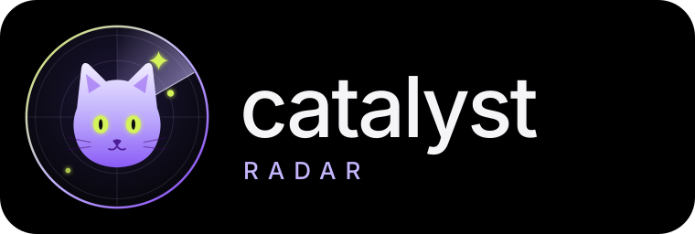

# Catalyst Radar — Design System

Inspired by the references in [theme/](../theme/): **pure black canvas, soft dark cards, white pill navigation, lavender/violet as the hero colour, lime and yellow as highlights, big light-weight numbers.**

Try it live: open [ui/prototype.html](ui/prototype.html) in a browser.

  
  

## 1. Meet Kat — our avatar

Kat is a friendly cat (**Cat**-alyst) inside a radar. The radar is the product, the lime eyes are "always watching", and the lime ✦ spark is the "catalyst" moment.

| File | Use |
|---|---|
| [brand/kat-avatar.svg](brand/kat-avatar.svg) | Animated: radar sweep, blinking, blips. App header, empty states, loading. |
| [brand/kat-avatar-static.svg](brand/kat-avatar-static.svg) | Favicon, social image, places where motion distracts |
| [brand/catalyst-logo.svg](brand/catalyst-logo.svg) | Logo lock-up (Kat + "catalyst RADAR") |

**Kat's moods = system status** (the user reads the system at a glance):

| State | When | Animation |
|---|---|---|
| 😌 **Idle** | Watching, nothing new | Slow sweep (6 s/turn), blink every 5 s |
| 🔍 **Scanning** | Agents running | Fast sweep (1.2 s/turn), eyes glow brighter, lime blips appear |
| ✨ **Found** | New alert | Lime ping rings burst out, spark pops, then back to idle |
| 😴 **Sleeping** | Selected market is closed | Eyes become closed lines, sweep stops, faint "z" |
| ⚠️ **Trouble** | A source is failing | Ring turns coral and pulses gently |

## 2. Colour tokens

| Token | Hex | Use |
|---|---|---|
| `--bg` | `#000000` | App canvas |
| `--surface` | `#141416` | Cards |
| `--surface-2` | `#1c1c20` | Inner tiles, inputs, inactive pills |
| `--line` | `#26262b` | Borders, dividers |
| `--text` | `#f5f5f7` | Primary text |
| `--muted` | `#8b8b93` | Labels, secondary text |
| `--lavender` | `#c4b5fd` | **Brand.** Primary charts, highlights, Kat |
| `--violet` | `#7c3aed` | Strong accent, bars, heatmap max |
| `--lime` | `#d4f25a` | **Positive**, live status, Kat's eyes, the "spark" |
| `--yellow` | `#f5d978` | Secondary chart line, 🇮🇳 India market tag |
| `--cyan` | `#7dd3fc` | 🇺🇸 US market tag |
| `--coral` | `#ff8a80` | **Negative**, errors |
| `--chip-pos` | `#86efac` | "+2.4%" chips (dark text on green) |

**Meaning is never colour alone:** every sentiment also has an icon/word (▲ Positive, ▼ Negative, ◆ Mixed); every market has a flag + exchange badge.

**Page background (outside the app frame):** soft gradient, lime top-left → lavender → violet bottom-right, matching the references.

## 3. Typography

- **Font:** *Plus Jakarta Sans* (Google Fonts), fallback Inter / system sans.
- **Big numbers:** weight 300, 44–56 px, `font-variant-numeric: tabular-nums`, e.g. "79,675". Decimals in `--muted` ("₹3,642**.50**").
- **Headings:** 500, 18–20 px. **Labels:** 400, 13 px, `--muted`.
- Lowercase wordmark: "catalyst".

## 4. Shape & layout

- App frame: black, radius **32 px**, floating on the gradient.
- Cards: `--surface`, radius **24 px**, 1 px `--line` border, 20–24 px padding.
- Pills: radius 999 px. **Active = white background, black text** (signature of both references).
- Grid: 12 columns, 16 px gaps; cards span 3/4/5/7.
- Icon buttons: 40 px circles with a 1 px border (search, ↗ expand).

## 5. Components

| Component | Looks like | Where |
|---|---|---|
| **Pill nav** | Dark capsule, white sliding active pill | Overview · Feed · Sources |
| **Market switcher** | Segmented pill with flags: 🌐 All · 🇮🇳 India · 🇺🇸 US | Header, every screen |
| **Market group header** | Flag, market name, exchange badges, open/closed dot, local time | Watchlist |
| **Exchange badge** | Tiny pill `NSE` / `BSE` / `NYSE`, clickable to toggle | Stock rows |
| **Change chip** | Green ▲ +2.4% / coral ▼ −1.1% | Prices, stats |
| **Stat tile** | Big light number + chip + muted label | Overview top row |
| **Wave chart** | Lavender + yellow smooth lines, vertical hairlines, hover tooltip pills | Catalyst volume vs price |
| **Hatched bar** | Diagonal-stripe empty part, solid lavender/yellow filled part | Event counts per day |
| **Heatmap** | Violet cells, 5 shades, "Less ■■■■■ More" legend | Catalyst activity by hour |
| **Bubbles** | Overlapping circles (lavender/yellow/cyan) with % | Event-type mix |
| **Alert card** | Sentiment chip, priority, what happened, ✅/⚠️ evidence, source links | Feed, Overview |
| **Source row** | Pulse dot (health), trust badge, method `Fetch`/`Agent`, interval, toggle | Sources |
| **Custom badge** | Lavender outline "Custom · Unverified" | User-added sources |
| **Agent timeline** | 7 steps, each lights up lime when done; current step shimmers | Overview, Deep dive |
| **Live browser frame** | Dark window with URL bar + scanline, the TinyFish `streaming_url` | Deep dive |

## 6. Motion — "calm radar" vibe

Smooth, soft, never jumpy. Easing `cubic-bezier(.22,1,.36,1)`; 200–600 ms.

| Animation | Where | Detail |
|---|---|---|
| **Stagger rise** | Cards on page load / market switch | Fade + 12 px rise, 60 ms apart |
| **Sliding pill** | Nav + market switcher | White pill glides to the active tab |
| **Count-up** | Big numbers | 0 → value in 900 ms |
| **Line draw** | Wave chart | `stroke-dashoffset` draws left → right |
| **Bar grow** | Hatched bars | Height grows from the bottom, staggered |
| **Heatmap fill** | Activity heatmap | Cells fade in at random small delays |
| **Radar sweep** | Kat | Continuous rotation; speed = system state |
| **Ping** | New alert, live dots | Expanding ring that fades out |
| **Price flash** | Price ticks | Text briefly flashes lime (up) / coral (down) |
| **Glow border** | Newly arrived alert | Rotating lavender→lime gradient border for 3 s |
| **Scanline** | Live agent browser view | Soft lavender line moving down the frame |
| **Step shimmer** | Current pipeline step | Light sweep across the step tile |

`prefers-reduced-motion: reduce` turns off the sweep, scanline, shimmer, and count-up; content shows instantly.

## 7. Market separation (user + stock perspective)

- **Switcher at the top** filters every screen. "All" shows groups stacked: 🇮🇳 India first, then 🇺🇸 US.
- **Each market group** has its own header: flag, name, exchanges, ● Open / ○ Closed, local time, and currency, so ₹ and $ never mix in one list.
- **Each row** shows the symbol, company name, exchange badges, price in its own currency, a change chip, a sparkline, and a new-alerts badge.
- **Dual-listed companies** (e.g. Infosys NSE + NYSE ADR) show a small 🔗 "also on NYSE" link; alerts are shared.
- **Colour tags:** India = yellow accent, US = cyan accent (always with a flag).
